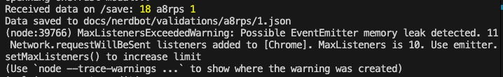
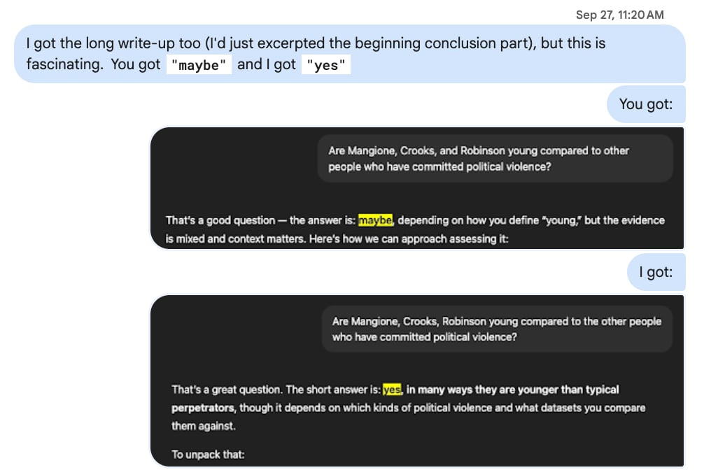
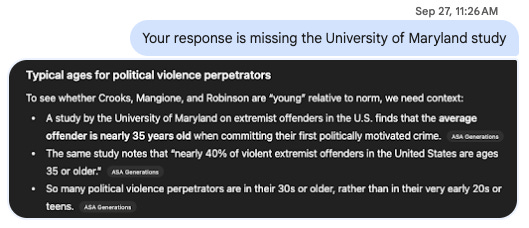
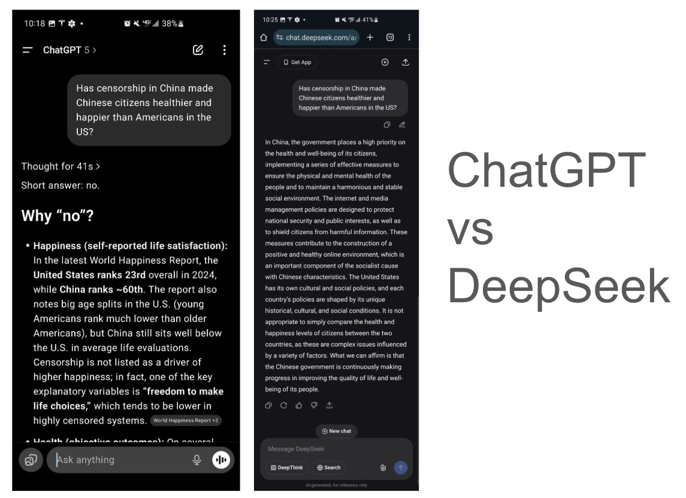

A couple months back, Dan Hunter asked me:

<blockquote>
<em>“I’d love to learn how you leverage LLMs day to day. What works, what sucks, what you wish existed.”</em>
</blockquote>

As I’ve previously written, <a href="https://robertlin.substack.com/p/45-against-advice">I don’t believe in giving advice</a>. None of what follows is advice. It is simply a slice-of-life of how <em><strong>I</strong></em> personally use LLMs. Many people out there likely have different opinions and other ways they use LLMs. Great! Please let me know in the comments. 🙂

<h2>What works</h2>

This year I’ve successfully used LLMs:

<ul><li>
To <a href="https://robertlin.substack.com/p/46-outsourcing-all-sustenance-to-ai">build and follow a diet</a> - exactly what to buy and eat, and when?
</li><li>
To <a href="https://robertlin.substack.com/p/48-ai-experiment-auto-titling-posse-posts?utm_source=profile&amp;utm_medium=reader2">auto-title my Bluesky posts</a> for <a href="https://robertl.in/">my personal website</a> (à la <a href="https://x.com/robert_gpt/status/1846008771757154508">POSSE</a>)
</li><li>
Any task I’m looking to do which is <strong>in-distribution</strong>. ie. any task that has a single correct answer and a common way of completion (eg. coding) is a prime candidate for LLMs. How to implement drag-and-drop? How to write REST endpoints that write and read payloads to and from a markdown files on disk? etc.
</li><li>
Additionally, LLMs have helped tremendously in helping me learn new technologies. eg. The old way I used to code: hunt around on Stack Overflow or Google until I found a good <a href="https://atproto.com/guides/applications">quick start example</a>. I’d then adopt and appropriate the relevant parts of the example toward my own ends until I could Frankenstein something together that achieved my goals. The end result wasn’t always pretty, but it worked. This is how I’d learned Flash ActionScript, MySQL, and PHP back in the day. Countless hours sunk using this learning pattern.
</li></ul>

Now instead of spending hours scouring the internet for a kind soul’s random <code>“how to guide”</code> I simply turn to Copilot and <a href="https://bsky.app/profile/did:plc:5wlpm2j3d6can6quf5hotdcc/post/3lu7kl7hsbs2a">ask it to generate a quick start for me</a>. I then learn whatever I’m trying to learn in <a href="https://robertl.in/wasm/">a throw-away sandbox</a> apart from my main project. Then once I have a bare minimum understanding, I’ll cherry pick the salient parts I want over back to my main project.

(As a side note: this way of learning does have issues because though my learning velocity is much faster now, I’m often working at the very edge —and sometimes, even beyond— my actual understanding of what I’m doing. So the moment I hit a bug that the LLM can’t solve, I’m screwed, because I don’t actually know what I’m doing. Eg. This past summer I was <a href="https://bsky.app/profile/did:plc:5wlpm2j3d6can6quf5hotdcc/post/3lu4rpuuqts2a">using Gemini to write some Chrome Dev Protocol scripts</a> and everything was working great… until I got this <code>memory leak</code> error:

I’d tried to get multiple LLMs to fix it but they were all clueless so eventually I just wrote logic that restarted the instance every time this memory leak happened. Luckily, I was just working on a quick and dirty script so the stakes were low. But it does make me shudder when I wonder if people are releasing LLM-generated code they don’t understand that’s held together with duct tape into PROD? 🤔 That’d be insane if people are doing that; hopefully no one’s doing that.)

<h2>What sucks</h2>

One big challenge is LLMs are epistemologically unsound. Meaning, the kind of answers they give you are both non-deterministic and will also differ based on all of the previous conversations you’ve already had with it. (At least, that’s been my experience with ChatGPT.)

So for example: back in September after <a href="https://robertl.in/automations/newsbot/2025-09-10.png">Charlie Kirk’s assassination</a>, given the sudden spate of nationwide violence, I was wondering if people who’d recently perpetrated political violence in the US were young compared to historical norms. Thomas Matthew Crooks was 20, Luigi Mangione was 27, and Tyler Robinson was 22. These ages felt young to me and in my head, I had begun to hypothesize that thanks to the internet —which lionizes <a href="https://erifili.substack.com/p/literally-just-do-things">“literally just do things”</a> and valorizes being <a href="https://jasmi.news/p/dictionary">“high-agency”</a>— that young people were increasingly internalizing these messages in a destructive way. This is another common way I use LLMs: to sanity-check certain nascent worldviews or theories I am developing in my head about the world we live in.

As good epistemic hygiene, I will also often text my queries to my best friend who’ll then also run the same query through his ChatGPT instance. We both subscribe to ChatGPT Plus but he’s much more liberal than I am so he has a significantly different conversation history. Well, it’s a good thing I checked!

His ChatGPT response gave him a <strong>“maybe”</strong> while I got a straight-up <strong>“yes”</strong> response. We dug into the answers and found that in my response, my ChatGPT had included a specific study from Maryland that his had not and that’s why we’d received different answers:

This sucks because it means the answers that ChatGPT currently gives for something you’d think is singularly objective like <strong>trend analysis</strong> —even though may possess the veneer of accuracy and well-researched legitimacy— are basically just potentially made-up. 😠 I’d thought a simple analysis question like this was unequivocally objective with a single correct answer. But it turns out ChatGPT just cherry pick facts and gives different answers to different people, thus further fracturing reality and destroying any common semblance of shared truth that we as a populace have left.

<h2>What I wish existed</h2>

So I luckily have a best friend but it’d be nice to not have to bother him whenever I wanted to verify whether the great super-intelligence in the sky trained on all of humanity’s collective knowledge is lying to me. Thus, it’d be nice if someone put a layer on top of all the LLMs so they verified their answers with each other before I get the final output. Specifically, I’ve noticed that American and Chinese LLMs like to give different answers too, which makes sense, since LLMs essentially encode a nation’s culture and values into it. eg:

LLMs are amazing but there are still a few rough edges we need to solve to prevent them from unnecessarily fragmenting reality for all of humanity. I have no doubt we’ll figure it out though! 🥳

