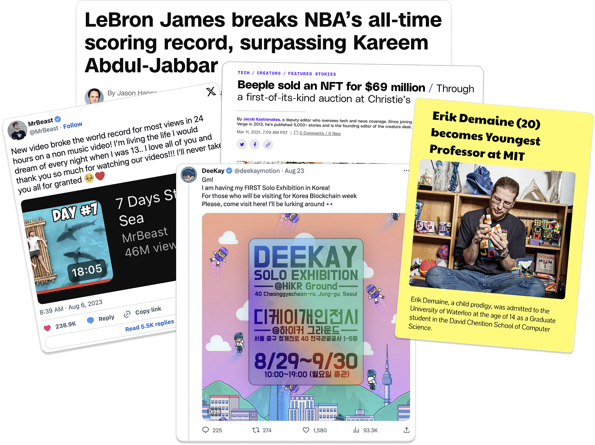
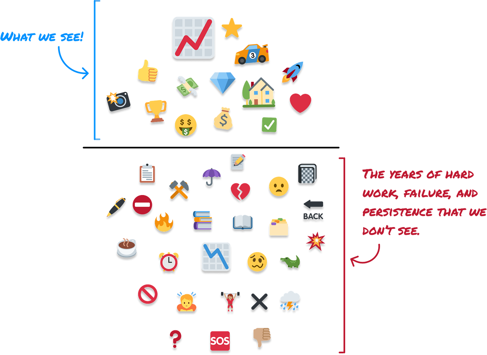
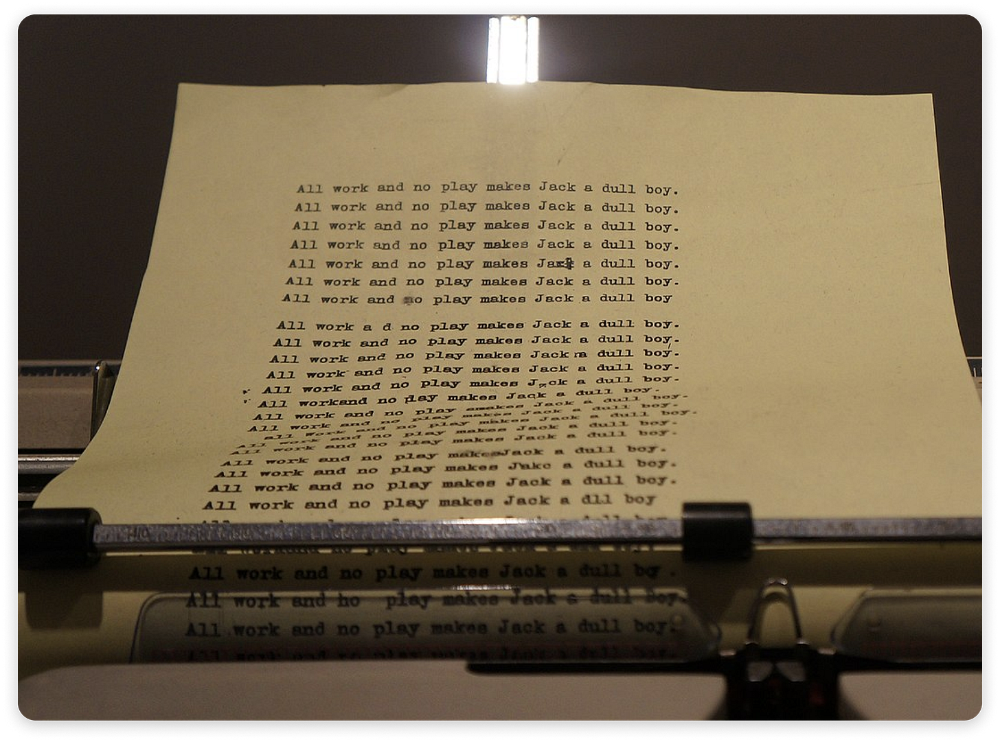
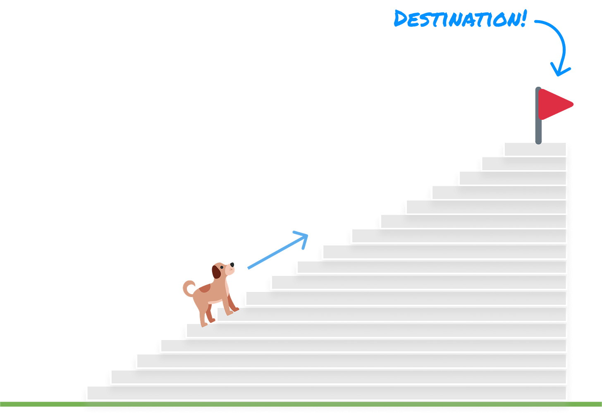
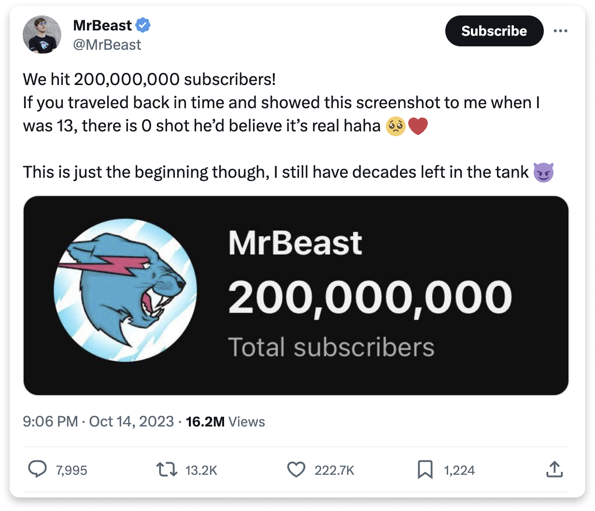

It often seems that success in a particular domain is reserved for a select few: 

However, the path to being successful at something is not as exclusive as it might appear. All of us are capable of being great at something and defining success on our own terms. The key ingredient here is <strong>intrinsic motivation</strong>.

<h2>Understanding Intrinsic Motivation</h2>

When we look around and observe people who have achieved something meaningful that we also strive towards, the classic iceberg principle applies. What we see on the surface hides something larger and deeper that we don’t see:

What we don’t see is the <em><strong>grind</strong></em>, the hard work, consistency, persistence, and the <a href="https://www.newyorker.com/sports/sporting-scene/complexity-and-the-ten-thousand-hour-rule">10,000-ish hours</a> of deliberate practice - which, for those of us keeping score, is around 417 days of <a href="https://commons.wikimedia.org/wiki/File:Stanley_Kubrick_The_Exhibition_-_LACMA_-_Shining_-_Adler_typewriter_%288999708038%29.jpg">non-stop focused work</a> without any time devoted to sleeping, eating, life-ing, and other essential downtimes:

Intrinsic motivation is the unlimited fuel for this grind. 

Unlike extrinsic motivation, which relies on external factors that we often can’t control like rewards or recognition, intrinsic motivation is fueled by personal passion, curiosity, and the sheer joy of the task itself. <strong>It's the desire to do something because it's deeply satisfying and meaningful.</strong> 

<h2>Recalibrating Success</h2>

What intrinsic motivation generates is a love for the <em><strong>process</strong></em> involved in making progress toward a goal:

When you start to love the process, external validation doesn’t matter anymore. You have your reasons for doing something. If you also happen to see external success, that is a side effect. It isn’t your destination. 

This is why many successful people never stop after reaching what seems like a great destination. Their inner momentum keeps them going.

To look at this play out in a few notable examples...

MrBeast started making videos over a decade ago when he was 13. Many of his earliest videos hardly had any views. He never gave up, especially in the early years. He kept making videos and improving one small thing with each new posting - a different narrative style, a new thumbnail design, etc.

A decade later, this persistence (unsurprisingly) <a href="https://x.com/mrbeast/status/1713405847089422378?s=46&amp;t=Y5Tscoz2pm1RD2loK7a1Sw">paid off</a>:

Joe Rogan may be a household name today, but he started podcasting in 2009. Few people listened to him for the first few years. He was just having fun chatting with his friends in a public forum and tweaking his formula. 

The <a href="https://en.wikipedia.org/wiki/The_Joe_Rogan_Experience#Spotify_era">much-talked-about Spotify deal</a> didn’t happen until 2015, well after thousands of episodes had already been aired. If Joe had started out with the singular goal of signing a major distribution deal, the chances of him persisting for years with little outward validation would be low.

Mike Winkelmann, more commonly known as <a href="https://www.beeple-crap.com/">beeple</a>, is very well known today as a successful artist and for selling one of <a href="https://www.theverge.com/2021/3/11/22325054/beeple-christies-nft-sale-cost-everydays-69-million">the most expensive NFTs</a>. Prior to that, he was known for publishing a work of art online every day for over 14 years. Yes, 14 years...every single day. 

He didn’t do this to get instant fame. He did this to get better at using various design tools. His consistency over this long period of time helped him be at the right place at the right time to capitalize on the growing crypto-influenced art movement.

The list of people to cover here is endless, and they all don’t have to be famous household names. Successful people who have achieved greatness in a particular domain are all around us. 

If we dig deeper into what helped them be successful, there is something we’ll see in common with all of them: <em><strong>they all shared a desire to be better today than they were yesterday</strong></em>. This desire is fueled by an intrinsic motivation that isn’t deterred by what does or doesn’t happen externally.

Cheers,

—KIRUPA 🍊 

