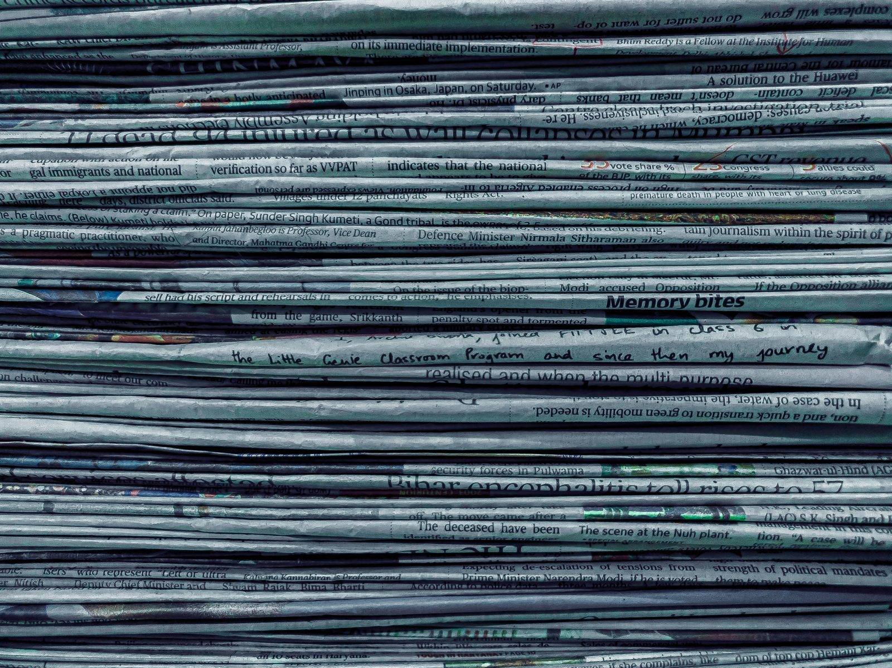

<em>Photo by <a href="https://unsplash.com/@utsavsrestha">Utsav Srestha</a> on <a href="https://unsplash.com">Unsplash</a></em>

At 6AM, I’d put on my school uniform while CNN anchors broke news about global markets and political scandals.

It was a strange contrast: the world felt like it was always on fire on the TV, while I was buttoning my shirt and packing my books. My mom would glance at the screen and say, “Imagine you being like that one day. <em>This is Becky Isjwara, reporting live from Jakarta.</em>” In that moment, it seemed like the future was secure: CNN would always be there, and maybe one day I would too. The irony, of course, is that by the time I entered journalism, that industry was already collapsing.

Like Robin from <em>How I Met Your Mother</em>, I started with the not-so-glam roles in reporting: interviewing knowledge workers in finance, typing out words behind a screen instead of having a glam team prep me for a 5AM broadcast. But somewhere between my nth scoop and pretending to care about compliance messaging software (as thrilling as it sounds), I realized a disconnect. The content I produced at work wasn’t the content I consumed after hours. Instead of CNN or <em>The Wall Street Journal</em>, I got my news fix from podcasts—Kara Swisher and Scott Galloway’s <em>Pivot</em> basically became my newspaper for half a decade.

<em>(This mirrored reality. Many TV producers go home to binge Netflix instead of their own network.)</em>

So like any confused sophomore, I dropped out. Instead of sticking it out in a newsroom, I launched a Substack. And oddly enough, I think I’m economically better off for it.

<strong>The Shift in Media</strong>

I wasn’t blazing trails. I was just following the journalists who were entrepreneurial before me. Kara Swisher, in particular, has always been my north star.

There is no denying that media consumption has shifted dramatically. Very few of us log into news sites anymore. We learn about politics on podcasts, get travel tips from TikTok, and watch explainers on YouTube. Fifty years ago, newspapers were the platform du jour. Today, content creators fill that role.

And when attention shifts, money follows. The average CNN show gets about 92,000 viewers, versus<a href="https://podcasts.apple.com/us/podcast/trumps-alive-china-flaunts-bffs-and-scotts-back/id1073226719?i=1000725133150&amp;l=zh-Hant-TW"> 400,000 for each </a><em><a href="https://podcasts.apple.com/us/podcast/trumps-alive-china-flaunts-bffs-and-scotts-back/id1073226719?i=1000725133150&amp;l=zh-Hant-TW">Pivot</a></em><a href="https://podcasts.apple.com/us/podcast/trumps-alive-china-flaunts-bffs-and-scotts-back/id1073226719?i=1000725133150&amp;l=zh-Hant-TW"> episode</a>. Advertisers have been redirecting dollars from newsrooms to creators. Meanwhile, traditional newsrooms are wilting to a slow death. I had been spared from a few layoffs while I was still a journalist, but I had always wanted to leave before I got on the chopping block.

<strong>Journalists Who Jumped Ship</strong>

In case you need more convincing, plenty of journalists have already made the leap, risking their probably pretty paychecks for a more adventurous income stream:

<ul><li>
<strong>Derek Thompson</strong> runs a Substack alongside his Atlantic work.
</li><li>
<strong>Becca Farsace</strong> does YouTube tech reviews the way Walt Mossberg once did for <em>The Wall Street Journal</em>.
</li><li>
<strong>Johnny Harris</strong> makes investigative YouTube videos for millions.
</li><li>
<strong>Casey Newton</strong> runs <em>Platformer</em>, a lean, independent newsletter.
</li><li>
Even non-traditional voices like <strong>Kyla Scanlon</strong> have built credibility from scratch—TikTok first, then Substack—without the need to be invited to a TV segment.
</li></ul>

They’re proof you don’t need a masthead to make money, impact, or both.

<strong>The Newsroom Advantage</strong>

Of course, this isn’t a simple story of triumph. Traditional newsrooms still offer real advantages: editorial oversight, fact-checking teams, legal protection (very important!!), and the institutional credibility that freelancers can struggle to match. Independent creators, meanwhile, face risks of income instability, algorithmic dependence, and the temptation to trade rigour for virality. Going solo also means bearing the full weight of production, distribution, and monetization—jobs that used to be spread across entire departments.

And there’s the question of investigative journalism—the part of the profession that made traditional reporting so compelling in the first place. Think of war correspondents or the Pulitzer-winning exposés like Jodi Kantor and Megan Twohey’s reporting on Harvey Weinstein. That kind of work is expensive, slow, and hard to balance with the day-to-day grind of algorithm-driven posting. For decades, newsrooms could fund these long investigations with bread-and-butter beats like sports, business, or entertainment. Without a diverse newsroom to cross-subsidise, stories that deserve to be told often struggle to find oxygen. One risk of a creator-led future is the slow death of local reporting and public-interest investigations. Unless a story has the potential to go viral, it risks being invisible.

These risks are worth naming, because they keep the playing field uneven. But the gravitational pull of money, audience trust, and autonomy has shifted too strongly to ignore. Even with the safety nets of legacy media, more and more journalists are concluding that the rewards of independence outweigh the comforts of the corporations.

<strong>Why the Creator Path Wins</strong>

The most obvious advantage for journalists to treat themselves like content creators is economic. When you own your distribution, the money follows you instead of your employer. Sponsorships, partnerships, and subscriptions are far easier to land when the audience is attached to your name rather than a masthead. Platforms like Substack now have<a href="https://post.substack.com/p/5-million"> 5 million paid subscriptions</a> globally.

There’s also the relationship factor. People swipe away banner ads or fast-forward through TV spots, but I’ll lean in when a podcaster or YouTuber I trust recommends a protein supplement. That intimacy creates a deeper connection between journalist-creators and their audiences, one that advertisers are willing to pay a premium to access.

The gatekeepers that once controlled who could publish are largely gone too. Platforms like Substack, YouTube, and LinkedIn make publishing free and direct. The people who subscribe, watch, or read are loyal to you, not the newsroom that used to employ you.

On top of that, there’s ownership. Everything you create belongs to you, which means you can repurpose it across formats, re-use it for future projects, or monetise it in ways a traditional newsroom contract would never allow.

And perhaps the biggest shift of all is leverage. When you control both your content and your audience, you’re no longer dependent on the whims of an editor-in-chief or a shrinking newsroom budget. Instead, you hold the bargaining chips—whether that’s for advertising, sponsorships, or entirely new ventures down the line.

The old aspiration was to work <em>for</em> a newsroom. Today, the smarter play might be to think like a content creator. Because when you own your content and your audience, you effectively own your future.

And sorry Mom, I never did make it to CNN. But I’ve got myself a job in the creator space earning a multiple of my reporter salary. And this time, there’s no editor killing my stories.

