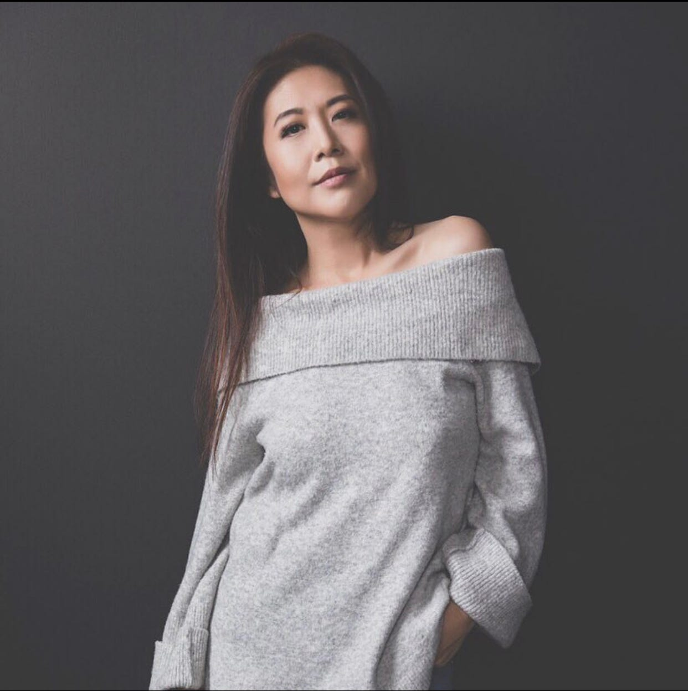

<aside class="guest-note">// from the host · Daniel Hunter
Today we have a heartfelt guest post from Grace Nikae who I met back in August. Grace entered Elon’s playground in June with <a href="https://x.com/kizunanyc/status/1699504884851130626">authenticity and boldness</a>. Her voice is desperately needed in a digital world that feels more filtered than ever.

I hope you enjoy this piece.

— DKH
</aside>

I’ve loved many times in my life.

Deeply, exquisitely, painfully.

My first love was sound.

It bloomed through the vibrations of my mother’s laughter, the colors of a symphony, and the soft and hard contours of language.

I knew the different pitches in the barks of the neighbor’s dog, the snap of sizzling oil when my mother made my favorite meal, the alarming slam of the car door when my father came home.  

I understood life through sound and learned terror through its absence.

The first lesson my parents taught me was the absoluteness of silence.

I was never to speak of what happened within our walls. Uttering aloud what was solely meant for family would bring dishonor and shame to our name.

I felt it. Always.

The silence of the unspoken rattling against my chest, asking for release. 

But fear kept it firmly in check. Instead, I retreated deeper within and found solace at the piano.

Music became my voice. I uncovered it in the tender yearning of a cadence and the shimmer of harmonies.

My father’s fingers, curled tight into meaty fists, pounded out his own kind of music, a terrifying dissonance that produced nightmares, kept my mother pale and distant, and made my brother cry in dark corners.

Each time I played, I reminded myself that my hands were different.

My fingers stroked and leaped across the keys, cajoling the instrument to breathe life into sound, to create not destroy.

What emerged from the piano was both me and not me.

Who I was filtered through another’s language: the purity of Bach, the restlessness of Schumann, the poetic melancholy of Chopin, the torrential passion of Liszt and Rachmaninoff. 

Home became the piano bench, hiding behind the keys, cocooned in the safety of being alone on stage. Untouchable.

Music gently accepted me, enveloping me in unconditional love even as the internal silence threatened to drown me.

—-----------

I fell in love with ideas.

It awakened in the differing perspectives challenging me in new ways, the eager student-led discussions on how to create impact, the unrelenting promise of a city overflowing with the clashing exhilaration of life. 

I met him that first year in college. 

Charismatic and elegant, he possessed a commanding energy - an electrifying way of focusing and connecting to others - that immediately drew me in. 

An engineering major and the lead singer of an up-and-coming band, he came from a well-known family in upstate New York and embodied the image of the perfect Ivy Leaguer: good-looking, confident, promising, wealthy, and popular. 

At the beginning, we often joked about the intersection of our worlds: classical musician and rocker, artist and logician. I’d practice Tchaikovsky at the piano while he wrote a song on his guitar. 

We both did and did not make sense, a reverie glittering on centerstage under the thrilling bright lights of the city.

There were signs and actions that drew the concern of those around me. 

But I had fallen in love with the idea of us - on performing the expected image of us - and it hadn’t occurred to me that his charisma served to manipulate or that his charm deceptively masked a bottomless, violent rage.  

That was the year I clung to the delusion of perceived independence and the kernel of awakening adult sexual power even as it came at the expense of my identity. 

Each time he lost control, each time cruelty suffocated me in its grip, I tried to speak, to move my mouth and articulate my pain and need, to ask for help in the same way I spoke about ideas in academic discussions and media interviews, in professional arenas and for causes I believed in.

But the words stuck in my chest. My throat closed, blocking off the pathway, unwilling to give birth.

Bringing those words to life was more terrifying than his outbursts, a beast I could not release.

Instead, I disconnected from the tangled clamor inside and sealed my emotions within a cage of numb composure. 

I used my voice to soothe and placate, to apologize and excuse and cheerfully feign ignorance.

At least, I thought it was my voice. 

Maybe it was the voice of my mother, softly speaking to my father with quivering lips.

Or that of my brother, desperate for affection and pretending nothing was wrong.

All I knew was that the disembodied voice floating out of my mouth had the power to calm him, assuage his anger, ensure my physical safety, and keep the idea of who we were supposed to be in order.

And that was enough. 

Enough to almost believe the dark disquiet I pushed down within me would still.

—--------------

I fell in love with words.

It deepened with the satisfaction of form and structure, the broad shades of meaning, and the sheer pleasure unearthed in the richly imbued worlds of Poe, Marquez, Morrison, Mann, and Kundera.

Unlike my marriage to music, writing was a guilty pleasure, a secret, torrid love affair freeing me to explore my fantasies without judgment.

I hid behind a pen name and my words on the page, reveling in the fluid nuances of a phrase, delving into the depths of curiosity from the sanctuary of my laptop. 

I obsessively wrote novels, novellas, and short creative works, the ideas pouring out of me as if a dam had cracked open somewhere in my mind.

Strong, bold, deeply flawed women protagonists led every story, their identities shaping the world rather than the world shaping them.

Nothing constrained me in this realm. I was both creator and audience, building narratives that pushed boundaries and satisfied my needs.

Here, I could examine fear, love, neglect, and yearning through the distance of an intellectual lens. 

Here, I could take risks without fear of retribution. Here, I could vanquish the villain.

Here, my characters said what I could not, their worlds rippling, breaking apart, and healing back together in ways I could not control in my own life.

After publication, I delighted in the voices of readers, the boisterous noise as they added insights and new layers to my constructed, imagined worlds. 

I remained everywhere and nowhere - an anonymous, guarded being ensconced behind words and the voices of others. 

After all, it was the story, not me.

That mirage of creative freedom provided escape from the deafening silence now carefully tucked away and locked up tight.

—-------------------

I fell in love with the sword of justice. 

It burned within the adrenaline of battle and in the hopeful promise of change.  

In 4th grade, a group of three 6th graders mercilessly bullied a classmate.

It suddenly started one day for no other reason than out of boredom. 

Charlie had an air of fragility around him, a sad sensitivity reflected in dark eyes set within a sharp, angular face. 

Every day, the bullies delighted in chasing him after school, taunting him for his physical frailty and unkempt appearance. 

The rest of our class watched from a distance while the unspoken rattled against my chest.

Charlie ran fast and always escaped the hands of his tormentors, his gangly limbs dancing across the playground. 

I wondered how he’d learned to move with such swift nimbleness and if he also had secrets at home he couldn’t tell.

But one day, Charlie wasn’t fast enough.

The boys grabbed the back of his shirt and pulled him to the ground. They managed a few kicks before Charlie rolled, leaped up, and darted out of their way. 

He raced to the tall fence bordering the field and shimmied up the post, arms wrapped tight around metal, angular face pale in the bright sunlight.

His skinny frame became my brother’s tiny form curled in fetal position, arms protecting his head from my father’s blows. 

His hands became my mother’s thin hands, clawing at the door, desperate to flee my father’s fury.

The unspoken roared, its screams hammering against my ears and drowning the world in helpless grief until it ripped three words from my throat.

“Leave Charlie alone!”

The silence had finally spoken. Not for me, but for another.

And for one perfect moment, the rattling within settled.

The boys pushed my scrawny nine-year-old self to the ground, leaving behind bruises and scrapes but there was no pain.

There is no fear with what you already know.

The next week, I stood in front of my mother and brother before my father’s fists, daring him to strike, knowing he couldn’t because I had upcoming concerts and too many eyes on me.

An unexpressed promise formed between us that day.

I would keep his secrets, the silence that bound all of us in that house. 

And he could no longer hide from himself or from me. 

I had discovered a new kind of power, one that allowed me to speak without speaking.

Over the years, that raw nine-year-old voice strengthened, every repressed emotion transmuting and bursting through in the form of protective avenger.

I learned how to hone my blade, sharpening its edge to eviscerate with razor-sharp precision. 

From navigating the cutthroat ambitions of the music industry, to the calculated politics of the boardroom, to stages in front of the judgment of thousands, I turned my affinity for words into a symbolic weapon, using it to both rally others together and ruthlessly draw blood from perceived threats.

I wielded my sword against anyone who seized the voices of others: the men undermining women, the bigots preying upon the marginalized, those hurting and harming the people I love, those abusing power to oppress the powerless.

Armored like a tank and invulnerable within the realm of abstract principles and ideals, I said everything others could not or would not, willingly taking any hits that came my way.

As long as I shielded the pain for others, I could deny the reality of my own.

As long as I used my voice for advocacy, I could distract myself from speaking my own truth, fueled by the conviction that what I did for others was of greater importance and significance.

Yet, the caged silence still trembled.

And I often wondered when someone would notice and deem it worthy enough to unsheath their own blade to protect and free it.

—----

As I write this, I am in my New York apartment. A grey drizzle has blanketed the city in a fine mist and the chill reminds me that it’ll soon be time for coat weather.

Change is upon us again.

I look back on those periods of my life and consider how much of my art, language, and choices were mine and how much of it belonged or were in reaction to others.

Perhaps it is all and none at the same time.

An individual voice is easily heard in isolated silence, but can only be shaped and forged within the context of other voices.

The how and why of our expression could not exist without those who tried to suppress, influence, or control it, without refracting through the prism of our experiences. 

Self-understanding ultimately emerges through this paradox, the contradictory tension erupting from the push-pull of who we were and who we have yet to be.

I’ve loved many times in my life.

Deeply, exquisitely, painfully.

And yet, I hadn’t dared to risk falling for the one person whom I had never been able to accept, forgive, or acknowledge as worthy enough.

Because this love requires shedding costumes and armor, relinquishing control and fear, and leaving the refuge of invulnerability to surrender to our humanity.

To be human means to be scarred memory and untouched imagination, bounded mortality and ceaseless possibility, bleeding disbelief and renewed longing. 

The deepest connection we seek and yearn for is not with another.

It is with who we are.

It may have taken a lifetime of loves to love myself.

But when I did, I unlocked the cage and the silence finally soared free.

— Grace Nikae 

