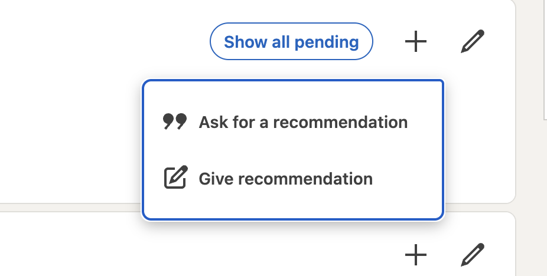
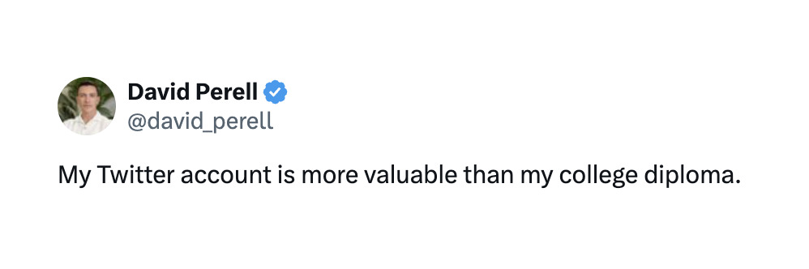
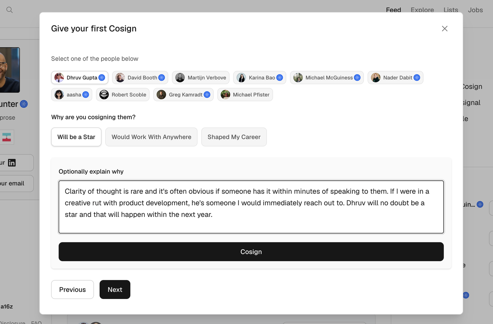
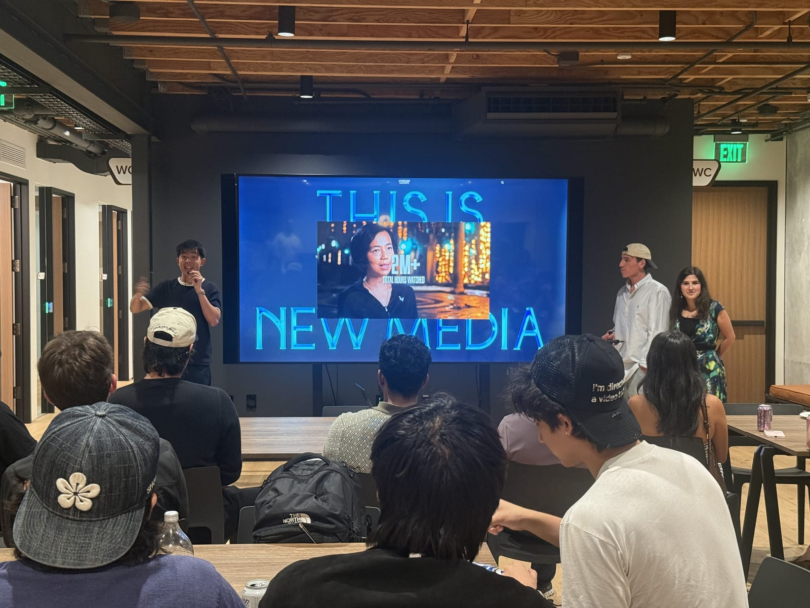

## Someone believed in me

In 2018, [Jon Gosier](https://www.linkedin.com/in/jongos/) sent me a message saying he was going to introduce me to [Bob Moore](https://www.linkedin.com/in/robertjmoore/). I did not ask for an intro, but I damn sure earned it.

I was the second engineer hired at [Audigent](https://audigent.com/), a company Jon co-founded in Philly back in 2015. When I started, we were living off a small friends-and-family round, with less than six months of runway before the money ran out. I was all in. 60-70 hour work weeks, heated but respectful debates, and an obsession with making our MVP demo well. Jon saw it all. Respect was earned.

We survived and Audigent was later [acquired by Experian for $363 million](https://www.experianplc.com/content/dam/marketing/global/plc/en/assets/documents/reports/2025/635400RXXHHYT1JTSZ26-2025-03-31-viewer.html).

Bob Moore, the CEO of [Crossbeam](https://www.crossbeam.com/), was a bit of a legend in the Philly startup ecosystem. Getting a meeting with him was a "cancel all your plans" type of situation. Jon's intro got me an interview and laid the foundation for a senior engineering role.

I had the talent, and I was ready. But being talented and prepared often isn't enough. Many of us stay ready. We’re hungry. But you need someone to believe in you and mention your name when you're not in the room. Jon did that for me. He was my first professional cosigner in tech.

## Cosign, On Deck

When I hear the word *cosign*, I’m reminded of all the apartments in Boston I couldn't get into during my college days without help from my parents. I think about the seriousness of the cosigner commitment for mortgage and loan applications. A cosigner is making a legally binding promise. If you can't pay, they will, or their credit score goes down the toilet with yours.

Being a cosigner is no joke, which is why it's something you rarely, if ever, ask for or do. A professional cosign, like a stamp of approval for a former coworker, doesn't carry the same level of risk, but it’s naturally uncommon. Cosigns are earned first, given second. Recommendations should not be requested haphazardly with the click of a button.

<em>Asking for a recommendation on LinkedIn</em>

[Cosign](https://cosign.co/), a new professional network from [a16z's New Media team](https://a16zjobs.substack.com/p/introducing-cosign-a-new-space-to) that launched on September 25th, is built around that idea. On Cosign, there's no way to ask someone for public praise. It's my favorite subtle design choice in the product.

<blockquote class="twitter-tweet" data-dnt="true">
	
Excited to introduce <a href="https://x.com/cosign">@Cosign</a>: the curated professional network for the startup community: <a href="https://cosign.co/">cosign.co</a>  Our goal is to create the following:  - A comprehensive startup directory of investors, companies, and operators, including what they worked on and who they worked on it with.  - Cosign graph: Who shaped your career? Who were you actually in the trenches with? Who would work with you again? Who thinks you’re someone to watch?  - Durable reputation: Great endorsements happen every day on X and disappear into the feed. Cosign attaches those signals permanently to people and companies.  - Discovery: Who are the best fintech angels? Which AI companies should I watch? Who are the best designers?  - Intent network: Privately signal “I’d invest in them,” “I’d hire them,” “I’d work with them,” or eventually even “I’d acquire this company.” Match people when interest exists on both sides.  Imagine if Wikipedia, LinkedIn, and OG AngelList had a baby. Though Cosign is a community, not a business.  In order to join, you need to be cosigned. Or you can apply directly.  David Booth and I started this idea 7 years ago but didn’t have the firepower to make it work. Now we do.  No one has really touched LinkedIn in 20 years. Excited to take a swing.  <a href="https://cosign.co/">cosign.co</a>

	&mdash; Erik Torenberg (@eriktorenberg) <a href="https://x.com/eriktorenberg/status/2103493671866060958">September 25, 2026</a>
</blockquote>

## When credentials get cheap

AI has made it nearly free to look impressive on paper. A polished resume, a tailored cover letter, and a slick portfolio site can now be brought to life in a single afternoon. When everyone looks talented and prepared, the pretty pages stop telling the full story, and you have to dig deeper to know whether a person is worth your time.

When someone important follows you on X, it's an implicit endorsement. Cosign wants to make it explicit. Erik Torenberg, a general partner at a16z, posed an interesting thought experiment.

<blockquote>

What's more impressive to you: someone who went to Stanford, or someone who is followed by Patrick Collison, Elon Musk, and Marc Andreessen? I think most people would say the latter. It's this kind of peer-to-peer credential.

— Erik Torenberg

</blockquote>

	<video
		src="/media/the-cosigns-you-dont-ask-for/et-web.mp4"
		controls
		playsinline
		preload="metadata"
		title="Erik Torenberg on peer-to-peer credentials"
	></video>

<em>Erik Torenberg on peer-to-peer credentials</em>

It's a seductive idea, and I'll come back to why it's also a risky one.

An elite degree is still a real signal, but it's an old one. It tells you someone got into a great school at 18, not what they built last year. It's also less rare than it feels. [Stanford alone handed out 2,140 bachelor's degrees in 2025](https://news.stanford.edu/stories/2025/06/commencement-ceremony-graduating-students). Multiply that across the Ivy League and every top state school (UCLA, Michigan, Texas, UVA, etc.), and the signal gets noisy fast.

A follow from the heavyweights in your field is much harder to get. Yes, anyone can ask for a follow on Twitter but almost no one does, because it's mortifying.

David Perell, one of my favorite writers and thinkers, follows fewer than a thousand people. I'd love it if he followed me, but I'd never ask. How ridiculous would that be? I’d look like a clown. Scarcity is what makes the network graph more legitimate and more meaningful than a CV alone.

The crew at Cosign is introducing a rarer signal, one that should get more meaningful over time. That signal is what separates it from LinkedIn, which has become a sales and go-to-market tool first and a professional network second.

<blockquote class="twitter-tweet" data-dnt="true">
	
Using <a href="https://x.com/pangram">@pangram</a> on LinkedIn is like seeing the AI matrix

	&mdash; Lenny Rachitsky (@lennysan) <a href="https://x.com/lennysan/status/2107241817184092652">October 5, 2026</a>
</blockquote>

But LinkedIn isn't really the competition. Cosign is competing with private networks, group chats, and IRL touchpoints. The social signaling that happens outside the social networks we use every day. It's about discovering real people, which is great for companies that are hiring and even better for people looking for their [next play](https://nextplay.so/).

## My name is on the line

I've been giving cosigns for years.

My brother and I run [Post in Black](https://postinblack.com/), a podcast where we've interviewed dozens of editors, music supervisors, sound editors, and VFX artists for the past six years. The people behind the scenes who rarely get covered. Eventually filmmakers in the industry started asking us who to hire. We've put our names on the line countless times without even blinking.

	<iframe
		src="https://www.youtube-nocookie.com/embed/pK8p8l7ooFE?rel=0"
		title="The Wild Reality of Breaking Into TV Editing | What They Don't Tell You..."
		loading="lazy"
		allow="fullscreen; picture-in-picture"
		allowfullscreen
	></iframe>

But it doesn't always work out.

We all have stories about referrals that went sideways. I once recommended a friend for a job on a short film, and they ended up not getting along with the producer and director. It eventually got really combative. The filmmakers hit me up and said they'd never work with my friend again. I still remember how shocked they were at the whole experience because the recommendation came from me, and I was a trusted source.

That's the cost of a cosign. Giving one takes five minutes, but a bad one isn't easily forgotten. Your name, out in public, attached to someone else's next move, can be expensive. One skeptic of Cosign [put it plainly](https://www.linkedin.com/posts/a16z_were-excited-to-launch-cosign-silicon-activity-7509260141385498624-q7Py): "A vouch only works as a signal that is costly if giving a bad one costs the voucher something later." That's fair, and it exposes a real tension. Offline, a bad recommendation definitely costs you. Online, and at scale, that cost can quietly disappear. If a bad cosign costs nothing, people will hand them out freely, and Cosign becomes LinkedIn wearing a different suit.

## If I’m wrong, it should cost something

Remember the cosigner on that apartment lease? Their signature means something because their credit score is on the line. The Cosign product needs its own version. Every cosign you give stays attached to your name, and over time that record should show how good your judgment is. A cosign from someone with a long history of backing the right people should count for more than one from someone who hands them out freely.

Full disclosure: I gave my first cosign to Dhruv Gupta, one of the product engineers at Cosign. We met because I was impressed with that platform and was eager to help. I haven't worked with him, but I've spent a meaningful amount of time inside the product he helps build. My Cosign fit under this category: Will be a Star. It's a bet, not a reference.

Notice what that screen is doing, though. Cosign handed me a list of ten people and asked me to pick one. Giving your first cosign is easy by design, which is exactly why the record has to matter. A prediction with a deadline is one way to build it.

A real record also means no take-backs, and Cosign already gets this right: once you give a cosign, you can't pull it. If you could quietly pull a cosign the moment someone disappoints you, giving one would cost you nothing. A bad cosign should sting, the same way a missed rent payment hits the cosigner's credit. That's what makes you think twice before you put your name next to someone else's.

## The good ol' boys club

There's some risk here with Cosign though.

Peer-to-peer credentials have an older name.

The group chats and back-channel references Cosign wants to bring into the open have historically worked best for people who were already inside.

Look closely at Torenberg's thought experiment. Being followed by Patrick Collison, Elon Musk, and Marc Andreessen is impressive precisely because almost nobody gets close enough to earn it. A credential that flows through who you know rewards the people who already know the right people. I hope the Cosign product doesn't turn into insiders vouching for insiders, where the socially rich get richer. If it does, it won't fix the problem with elite degrees.

To be fair, my intro to Bob came through who I knew, too. But Jon knew me because he'd watched me put in 60-70 hour weeks at a company that almost ran out of money. That's the line Cosign has to hold. A cosign should come from direct experience someone actually had.

Part of the fix has to happen offline. Cosign could borrow the Cursor community playbook: local chapters around the world, each run by an ambassador, where people demo what they're building to strangers who might vouch for them. The “Will be a Star” I used for Dhruv aligns well with this approach. If a cosign should come from work someone actually saw, outsiders need more rooms where their work gets seen.

<em>An a16z New Media event in Santa Monica</em>

Done right, that shrinks the insider advantage and brings more hidden gems to the surface. A cosign is worth the most when it's a new discovery for the viewer and not just a confirmation.

## Fin

Jon didn't owe me that intro to Bob, and he never asked for anything in return. He'd watched me work, and he was willing to put his name next to mine. That's what makes a cosign worth something.

Think about who spoke for you in a room you weren't invited into.

Think about who you could do that for.

Then put your name on the line for them.

— Daniel

	<a href="https://x.com/danielkhunter">x.com/danielkhunter</a>
	<a href="https://github.com/danielkhunter">github.com/danielkhunter</a>

