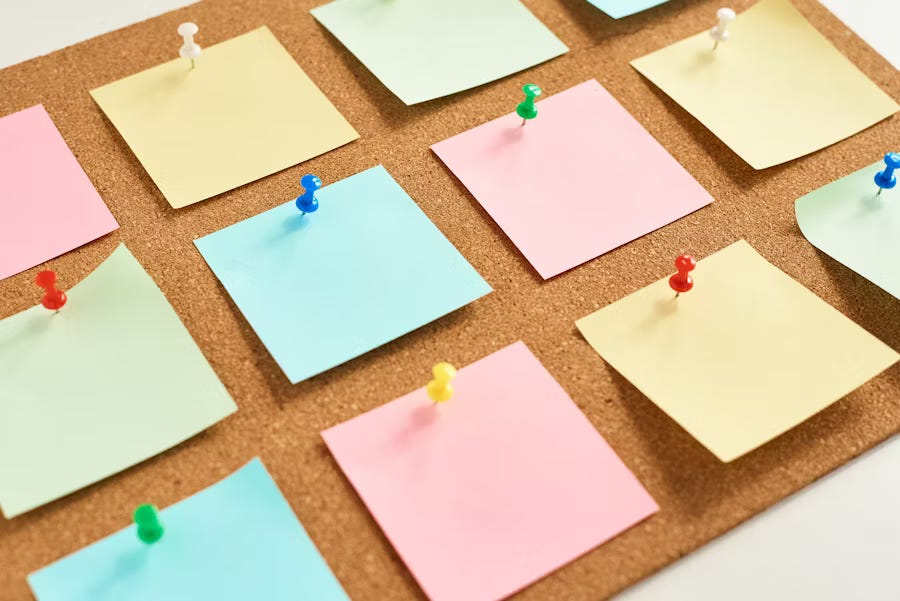

There’s this quiet pressure a lot of us carry: the pressure to look like we have it all together.

You know what I mean. The well-curated LinkedIn post, the vacation photo with the perfect sunset, the career update that sounds like everything is falling into place. We scroll and scroll and see people announcing promotions, side hustles, new houses, and somehow always looking fresh while doing it.

And even when we know it’s just the highlight reel, it still gets to us. Because if everyone else seems to be thriving, then what does that say about me, sitting here in sweatpants eating Trader Joe’s frozen gnocchi for the third night in a row?

<em>Photo on Unsplash</em>

<h2><strong>The truth is, nobody has it all together. Not really.</strong></h2>

Behind every “exciting update” is usually a mess of stress, doubts, and late-night Google searches about whether or not you’re ruining your life. That friend who looks like they’re crushing it at work? They’re secretly debating if they should quit and move somewhere quieter. That couple who always posts cute photos? They fought in the car right before taking it. The person who seems effortlessly productive? They probably have three unanswered texts from their mom sitting on read.

I’m not saying this to be cynical. I’m saying it because it’s comforting to remember. The myth of having it all together is just that: a myth. Nobody is doing it as perfectly as they look online.

<h2><strong>We’re all playing catch up</strong></h2>

I used to think I was the only one dropping the ball. I’d see friends running marathons or announcing a new certification, and meanwhile, my big accomplishment for the week was finally sending an email that had been sitting in my drafts for three days.

But when you actually talk to people, you start to realize almost everyone feels behind. Almost everyone is quietly comparing themselves. Almost everyone has that one part of their life that feels like it’s barely holding on.

It’s just that nobody posts about this.

<h2><strong>The whole idea of having it all together is flawed</strong></h2>

Sometimes I think about what “having it all together” even means. Is it about money? Career? A spotless home? A thriving social life? Because honestly, I’ve never met anyone who has all of those things at once. If you’re crushing it in your career, maybe your personal life is stretched thin. If you’ve got a full social calendar, maybe your bank account feels a little tight.

Maybe the whole idea is flawed from the start. Life isn’t about checking every box at the same time. It’s more like juggling, and you’re always dropping one ball while catching another.

And maybe that’s okay.

<h2><strong>Being real &gt;</strong></h2>

The older I get, the more I realize the real win is just showing up for your life as it is. Eating the leftovers. Letting the texts wait a day. Admitting you don’t have all the answers.

Because honestly? The people who matter don’t need you to have it all together. They just need you to be real with them. To say, “hey, today was a lot” or “no, I didn’t get that thing done.” That’s the kind of honesty that makes other people exhale and say, “me too.”

And I think we could all use more of that.

So if you’ve been feeling like you’re the only one fumbling while everyone else is thriving, here’s your reminder: you’re not. We’re all just doing our best, in our own messy, imperfect ways.

Some days, that looks like a promotion or a big win. Other days, it looks like surviving on coffee and leftover pasta.

Nobody has it all together. And maybe that’s the point.

Thank you for reading, Max

