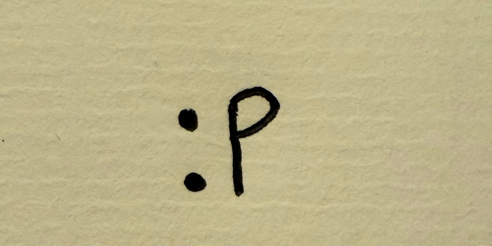

<em><a href="https://ngenart.substack.com/">Re: Pete</a></em>

Writing is an art.

To me, thereʼs no denying that.

But in the past few years, with the explosion of short-form writing on Twitter, LinkedIn, and even newsletters, writing has become something else entirely: a growth lever to be hacked.

So let me plead with you: stop writing everything like a growth marketer. 

Write like an artist.

Iʼm Pete, a 28-year-old “artistˮ living in New York. I put artist in quotes because for a long time I wasnʼt sure if I fit the label.

Three years ago I quit my cushy consulting job to explore the idea of turning personal data into artwork. Think: a piece of art on your wall that changes with the weather or every time you go for a run.

Along the way, Iʼve called myself a founder, a consumer app developer, an engineer. None of those quite fit. Over the past year, Iʼve finally settled into the identity of an artist.

A little over a year ago, I started publishing a short piece of writing every Monday. Iʼve written and published to Substack for 63 weeks straight. I thought it would grow my audience and help me make the jump into short-form content.

Spoilers: it didnʼt. Well, not in the way I hoped, anyway.

But what it did do was show me something important: I hated writing for growth, and I loved writing to write.

<h2><strong>Choose Curiosity Over Consumption</strong></h2>

So what does writing like an artist actually mean?

For me, it means treating writing the same way I treat my art: not as content to be consumed, but as an idea to be explored. It means following my curiosities, even when they donʼt fit into a neat growth framework or some trending topic.

Every time I chased a trend, the writing was flat. I tried writing about the influence of AI during peak “did A.I. write this?ˮ discourse, and no one cared at all. It was just another take on the take wheel. <a href="https://substack.com/@petecybriwsky/p-149845806">Hereʼs that <s>garbage</s> piece</a>.

But when I dug into something I was genuinely obsessed with, people connected with it. My dad would send me an email, a friend would shoot me a text, a stranger would reach out and say a piece inspired them. My most engaged piece? <a href="https://substack.com/@petecybriwsky/p-169360223">How I canʼt talk to my girlfriendʼs grandma</a>.

Itʼs worth remembering that art, whether on a canvas or on the page, is ultimately about conversation.

<h2><strong>From Content to Conversation</strong></h2>

Too often, creators treat their work as something to be consumed. Write a post, hit publish, watch the clicks roll in. But the most powerful moments donʼt come from passive consumption. They come when you create space for people to gather around the work, connect with it, and start a dialogue. Thatʼs what feeds both you and your audience.

I learned that lesson most viscerally last month, when I held my first gallery after years of tinkering and sharing only on the internet. For the first time, people could actually see my work. They touched it. They asked questions. They lingered in front of it and heard me give my spiel.

And what struck me most wasnʼt just that I was energized by them. It was that they were energized by each other. The room filled with curiosity. People brought their own ideas and perspectives Iʼd never considered. The work became bigger than me.

Thatʼs the part writers often forget. Live events, gatherings, workshops, they donʼt just grow your audience. They turn your work into a shared conversation. And in that space, everybody walks away with more energy than they came in with.

<h2><strong>My Invitation to You</strong></h2>

Of course, all writing has its place. Growth tactics, promotional posts, SEO-friendly pieces — they serve their purpose. But theyʼre not strictly necessary. And if thatʼs all you do, you risk missing the point and, most importantly, the magic of writing.

Because the most enduring writing doesnʼt just fill some arbitrary content calendar. It sparks conversation and curiosity.

So if you want to grow as a writer, hereʼs my advice: stop thinking like a marketer and start thinking like an artist.

Choose curiosity over growth. Treat writing as conversation, not content. Donʼt just publish into the void, put yourself in the room. Start the dialogue. Let people bump into your work.

Stop asking how to grow faster, and start asking whatʼs genuinely worth exploring.

Thatʼs the work people want to gather around. Make the space for them to gather, and the conversation will take care of itself.

